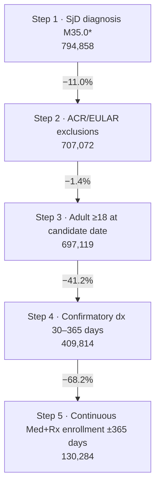
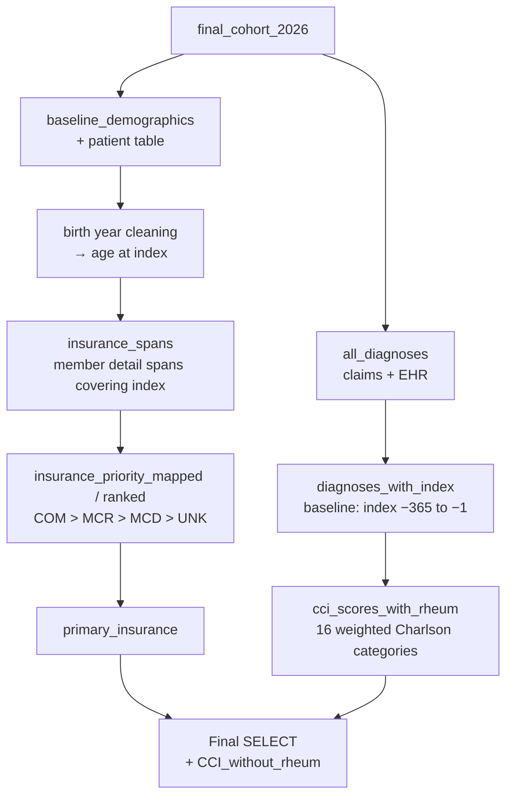

# SjD Patient Funnel 2026 — Cohort Selection (130,284 Patients)
 
**Data source:** Optum Market Clarity — Sjögren's / Graves' Disease Cohort
**Schema:** `market_clarity_graves_disease_202605_v1_20260622_prod`
**SQL dialect:** Trino / Presto (e.g., AWS Athena)
**Output grain:** One row per patient (`ptid`)
**Final cohort size:** **130,284 patients**
 
---
 
## 1. Purpose
 
This query builds the **final Sjögren's disease (SjD) study cohort** for the 2026 HEOR analyses. A patient enters the cohort when all of the following hold:
 
1. They have a recorded SjD diagnosis.
2. They have none of the ACR/EULAR exclusion conditions.
3. They are an adult at the diagnosis date.
4. The diagnosis is **confirmed by a second SjD diagnosis 30–365 days later**.
5. They have continuous medical and pharmacy enrollment for one year before and one year after the index date.
The **index date** (`date_of_first_diagnosis`) is the earliest diagnosis date that meets all of these rules.
 
The output feeds the downstream analyses. These include baseline characteristics and CCI, systemic manifestations and severity, treatment patterns, HCRU, and cost.
 
---
 
## 2. Patient Funnel
 
| Step | Criterion | Patients | Change from previous step | Code step |
|---|---|---|---|---|
| 1 | **SjD diagnosis:** at least one SjD code (ICD-10-CM `M35.0*`) recorded between Oct 2021 and Mar 2025 | **794,858** | — | `filter0_sjd` |
| 2 | **ACR/EULAR exclusions:** removal of patients with prespecified SjD exclusion conditions (Jan 2015 – Mar 2026) | **707,072** | −87,786 (−11.0%) | `filter1_sjd` |
| 3 | **Adult:** aged 18 or older at the candidate SjD diagnosis date | **697,119** | −9,953 (−1.4%) | `age_all_dates` |
| 4 | **Confirmatory diagnosis:** at least one more SjD diagnosis 30–365 days after the candidate diagnosis | **409,814** | −287,305 (−41.2%) | `sjd_pairs` |
| 5 | **Continuous enrollment:** medical + pharmacy coverage for 365 days before index and at least 365 days after index (variable follow-up) | **130,284** | −279,530 (−68.2%) | `qualified_index_dates` → `index_define` |
 
**Overall:** 16.4% of patients with an SjD diagnosis (130,284 of 794,858) form the final population.
 
*The counts come from the project funnel slide. The slide shows the adult step as "1%"; the drop is 1.4%. The screenshot cuts off below step 5, so any later step is not covered here.*
 

 
---
 
## 3. Data Sources
 
### 3.1 Source tables (Optum Market Clarity)
 
| Table | Data type | Fields used |
|---|---|---|
| `argenx_graves_202605_clm_med_diag` | Medical claim diagnoses | `ptid`, `diag`, `fst_dt` |
| `argenx_graves_202605_diag` | EHR diagnoses | `ptid`, `diagnosis_cd`, `diag_date` |
| `argenx_graves_202605_pt` | Patient demographics and mortality | `ptid`, `birth_yr`, `deceased_indicator`, `date_of_death` |
| `argenx_graves_202605_clm_con_enrl` | Continuous enrollment spans | `ptid`, `eligeff`, `eligend`, `coverage_ind` |
 
The schema name indicates a **May 2026 data cut (`202605`), version 1, built 22 June 2026**. *(Inferred from the naming convention — confirm with the data engineering team.)*
 
### 3.2 Upstream and downstream objects
 
| Object | Direction | Role |
|---|---|---|
| `excluded_patients_2026` | Input | Patients with ACR/EULAR exclusion conditions (IgG4-related disease, GVHD, sarcoidosis, amyloidosis, HIV, hepatitis C, head and neck cancer as a stand-in for radiation), Jan 2015 – Mar 2026. Built by a separate script. |
| `final_cohort_2026` | Input to the final `SELECT` / output of `index_define` | The cohort with `ptid` and `date_of_first_diagnosis`. |
| `final_cohort_2026_updated` *(likely)* | Output | The final `SELECT` adds `eligeff` and `eligend_mod`. The manifestation/severity script reads these columns from `final_cohort_2026_updated`. |
 
---
 
## 4. Processing Logic
 
| CTE | What it does |
|---|---|
| `filter0_sjd` | Collects SjD diagnoses (`M350%`) from claims and EHR between 2021-10-01 and 2026-03-31. |
| `deceased_patients` | Finds patients flagged as deceased who have no date of death. |
| `deceased_with_post_death_activity` | Finds SjD patients with any diagnosis recorded after the end of their death month. |
| `filter1_sjd` | Removes the ACR/EULAR-excluded patients and the two death-quality groups. |
| `sjd_dates` | Lists the distinct SjD diagnosis dates for each patient. |
| `age_all_dates` | Calculates age at every diagnosis date and keeps only the dates where the patient was an adult. |
| `sjd_pairs` | Pairs each adult diagnosis date with any later SjD diagnosis 30–365 days after it. |
| `death_info`, `enroll_spans` | Pull Med+Rx enrollment spans. Each span's end date is capped at the death date and at 2026-03-31. |
| `enrollment_flag` | Checks each diagnosis date for continuous enrollment from 365 days before to 365 days after. |
| `qualified_index_dates` | Keeps the earlier date of each pair, provided it is also continuously enrolled. |
| `index_define` | Takes the earliest qualifying date per patient as `date_of_first_diagnosis`. |
| Final `SELECT` | Reads `final_cohort_2026` and adds the enrollment span (`eligeff`, `eligend_mod`) that contains the index date. |
 
---
 
## 5. Business Rules
 
**BR-01 — SjD diagnosis codes.** Codes are upper-cased, trimmed, and stripped of dots. Any code starting with `M350` qualifies, which covers ICD-10-CM M35.0 and all its subcodes. Both claims (`fst_dt`) and EHR (`diag_date`) diagnoses count.
 
**BR-02 — Diagnosis window.** The code collects diagnoses from 2021-10-01 to **2026-03-31**. The slide describes step 1 as Oct 2021 – **Mar 2025**; see Section 8, item 2.
 
**BR-03 — ACR/EULAR exclusions.** Patients in `excluded_patients_2026` are removed.
 
**BR-04 — Deceased with no death date.** Patients with `deceased_indicator = '1'` and no recorded `date_of_death` are removed, because their follow-up cannot be measured.
 
**BR-05 — Activity after death.** A patient who is flagged as deceased or has a death date is removed if they have any medical-claim or EHR diagnosis dated after the **last day of the death month**. Death dates are stored as year and month only (`YYYYMM`). Patients whose death date cannot be parsed are not removed.
 
**BR-06 — Birth year.** The top-coded values `'1937 and Earlier'` and `'1936 and Earlier'` become 1937 and 1936. `'Unknown'` and any other non-numeric value become null.
 
**BR-07 — Adult at candidate date.** Age is calculated as the year of the diagnosis minus the birth year. Only dates where the patient is 18 or older remain as candidates. Patients with an unknown birth year are dropped.
 
**BR-08 — Confirmatory diagnosis.** A candidate date is confirmed when the same patient has another adult SjD diagnosis **30 to 365 days later** (inclusive). The confirming diagnosis can fall up to 2026-03-31.
 
**BR-09 — Enrollment spans.** Only `coverage_ind = 'Med+Rx'` spans are used. Each span ends at the earliest of three dates: the recorded `eligend`, the death date (first day of the death month), and 2026-03-31.
 
**BR-10 — Continuous enrollment.** A candidate date qualifies when **one single span** starts on or before candidate − 365 days and ends on or after candidate + 365 days. Follow-up can run longer than one year, up to `eligend_mod`.
 
**BR-11 — Index date.** The index date is the **earliest** candidate date that is adult, confirmed, and continuously enrolled.
 
**BR-12 — Effective index window.** Enrollment is capped at 2026-03-31 and must last 365 days after the index date. So in practice, every index date falls between **2021-10-01 and about 2025-03-31**. This matches the slide's window, even though the code collects diagnoses to 2026.
 
**BR-13 — Enrollment attached to the output.** The final output adds the enrollment span that contains the index date. Its `eligend_mod` marks the end of each patient's follow-up.
 
---
 
## 6. Output Specification
 
| Column | Description |
|---|---|
| `ptid` | Optum de-identified patient ID |
| `date_of_first_diagnosis` | Index date |
| *(any other columns stored in `final_cohort_2026`)* | Carried through unchanged |
| `eligeff` | Start of the Med+Rx enrollment span containing the index date |
| `eligend_mod` | End of that span, capped at death and 2026-03-31; this is the end of follow-up |
 
---
 
## 7. How to Reproduce the Funnel Counts
 
Run `SELECT COUNT(DISTINCT ptid)` against each CTE:
 
| Step | Count from |
|---|---|
| 1 | `filter0_sjd` (filtered to `event_date <= DATE '2025-03-31'` to match the slide) |
| 2 | `filter1_sjd` |
| 3 | `age_all_dates` |
| 4 | `sjd_pairs` |
| 5 | `index_define` |
 
To store the cohort, end the CTE chain with `CREATE TABLE final_cohort_2026 AS SELECT * FROM index_define`. Then run the final `SELECT` to add the enrollment span.
 
---
 
## 8. Assumptions, Limitations, and Points for Review
 
Items marked **Action** should be resolved before results are shared.
 
**1. The query will not run as written.**
- The first line begins with an em dash (`—-`), so it is not read as a SQL comment.
- The final `SELECT` reads the stored table `final_cohort_2026`, not the `index_define` CTE above it. On its own the statement only adds enrollment to an existing table, and does not rebuild the cohort.
**Action:** fix the header line, and document the step that creates `final_cohort_2026` from `index_define`.
 
**2. The step 1 window differs between the code and the slide.** `filter0_sjd` collects diagnoses to **2026-03-31**, but the slide's step 1 says Oct 2021 – **Mar 2025**. The final cohort is not affected (see BR-12), but the step 1 count depends on the window used. **Action:** confirm which window produced 794,858 and use the same one in both the code and the slide.
 
**3. Death-quality exclusions are not shown on the funnel.** BR-04 and BR-05 remove patients at the same point as the ACR/EULAR exclusions. Step 2's −11% therefore includes both. **Action:** show the death-quality removals as their own step, or note them in step 2.
 
**4. `NOT IN` and null IDs.** If `excluded_patients_2026` or either death list contains a null `ptid`, the `NOT IN` filters return no rows at all. **Action:** use `NOT EXISTS`, or filter out null IDs.
 
**5. A single span must cover the full ±365 days.** Two back-to-back spans with no gap, such as after a plan change, fail the check. This is not an issue if `clm_con_enrl` already merges adjacent spans. **Action:** confirm how the table builds its spans.
 
**6. The output can duplicate patients.** The final `SELECT` left-joins any span containing the index date. Overlapping or duplicated spans would create more than one row per patient. The join also compares the raw `ptid` with a trimmed, upper-cased `ptid`. **Action:** confirm there is one row per patient (expected 130,284 rows).
 
**7. Two death-date conventions.** The post-death check uses the **last** day of the death month, while the enrollment cap uses the **first** day. A patient who dies during their 365th day of follow-up could fail enrollment by a few days.
 
**8. Age is approximate.** Age is calculated from calendar years only, so a patient who is 17 on the diagnosis date can be counted as 18.
 
**9. This is a prevalent cohort.** There is no washout period. Patients first diagnosed before October 2021 can enter with a later index date.
 
**10. All EHR diagnosis statuses count.** "History of" or "possible" SjD diagnoses in the EHR count as both candidate and confirming diagnoses.
 
**11. This algorithm differs from the T01 V6 funnel.** The T01 V6 funnel (`T01_PAT_FUNNEL_V6`) confirmed a diagnosis with a second diagnosis **at least 7 days** later **or** a positive anti-SSA/SSB lab. It also required enrollment through the confirmation date. This funnel requires a second diagnosis **30–365 days** later and does not use labs. The two cohorts will differ.
 
**12. `excluded_patients_2026` is not documented in this script.** If it was built with the same code lists as the V6 funnel, the ICD-9 hepatitis C codes may be missing their leading zero (e.g., `7051` instead of `07051`). See `README_SjD_Funnel_V6.md`, Section 9. **Action:** check the exclusion-list build.
 
---
 
## 9. Suggested Quality Checks
 
1. Reproduce each funnel count (Section 7) and compare it with the slide.
2. Confirm the final table has 130,284 distinct patients and one row per `ptid`.
3. Plot the distribution of `date_of_first_diagnosis` by quarter. No index date should fall after 2025-03-31.
4. Check that `eligend_mod` is at least index + 365 days for every patient.
5. Look at the distribution of the gap between the candidate and confirming diagnoses.
---
 
## 10. Glossary
 
| Term | Definition |
|---|---|
| SjD | Sjögren's disease (ICD-10-CM `M35.0x`) |
| ACR/EULAR | American College of Rheumatology / European League Against Rheumatism 2016 classification criteria |
| Candidate date | Any adult SjD diagnosis date that could become the index date |
| Confirmatory diagnosis | A second SjD diagnosis 30–365 days after the candidate date |
| Med+Rx | Enrollment that covers both medical and pharmacy benefits |
| `eligend_mod` | End of enrollment, capped at death and the data cutoff |
 
---
 
## 11. Document Control
 
| Field | Value |
|---|---|
| Owner | *TBD* |
| Reviewer | *TBD* |
| Data cut | May 2026 (`202605`), v1, built 2026-06-22 |
| Final cohort | 130,284 patients |
| Last updated | *TBD* |
 
– baseline characteristics

# Baseline Characteristics & Charlson Comorbidity Index (CCI)
 
**Data source:** Optum Market Clarity — Sjögren's / Graves' Disease Cohort
**Schema:** `market_clarity_graves_disease_202605_v1_20260622_prod`
**SQL dialect:** Trino / Presto (e.g., AWS Athena)
**Population:** Final SjD cohort, `final_cohort_2026` (130,284 patients; see `README_Patient_Funnel.md`)
**Output grain:** One row per patient (`ptid`)
 
---
 
## 1. Purpose
 
This query builds the **baseline characteristics table** for the SjD study cohort. For each patient it gives:
 
- **Demographics:** age at index, gender, race, ethnicity, and geographic region.
- **Insurance:** the primary payer type at the index date, chosen by a priority rule.
- **Comorbidity burden:** a **Charlson Comorbidity Index (CCI)** score for the 365 days before index. The **rheumatologic disease** component is left out, because SjD is itself a rheumatic disease and would otherwise add to every patient's score.
These fields populate the baseline characteristics table (Table 1) of the study report.
 
---
 
## 2. Data Sources
 
### 2.1 Source tables (Optum Market Clarity)
 
| Table | Data type | Fields used |
|---|---|---|
| `argenx_graves_202605_pt` | Patient demographics | `ptid`, `birth_yr`, `gender`, `race`, `ethnicity`, `region` |
| `argenx_graves_202605_clm_med_diag` | Medical claim diagnoses | `ptid`, `diag`, `fst_dt` |
| `argenx_graves_202605_diag` | EHR diagnoses | `ptid`, `diagnosis_cd`, `diag_date` |
| `argenx_graves_202605_clm_mbr_dtl` | Member enrollment detail, including line of business | `ptid`, `eligeff`, `eligend`, `bus` |
 
The schema name indicates a **May 2026 data cut (`202605`), version 1, built 22 June 2026**. *(Inferred from the naming convention — confirm with the data engineering team.)*
 
### 2.2 Upstream dependency
 
| Object | Role | Required columns |
|---|---|---|
| `final_cohort_2026` | Final SjD cohort from the patient funnel | `ptid`, `date_of_first_diagnosis` (index date) |
 
---
 
## 3. Processing Logic
 

 
| CTE | What it does |
|---|---|
| `baseline_demographics` | Adds birth year, gender, race, ethnicity, and region to each cohort patient. |
| `birth_year_normalized` | Cleans the birth year (`'1937 and Earlier'` → 1937, `'Unknown'` → null). |
| `birth_date_corrected` | Converts the birth year to a date, using 1 January of that year. |
| `baseline_with_age` | Calculates age at the index date in whole years. |
| `all_diagnoses`, `diagnoses_with_index` | Gather all claims and EHR diagnoses for cohort patients and attach each patient's index date. |
| `cci_scores_with_rheum` | Scores each Charlson category from baseline diagnoses and adds them up to the CCI (rheumatologic disease is excluded from the total). |
| `insurance_spans` | Finds member enrollment spans that contain the index date. |
| `insurance_priority_mapped`, `insurance_ranked`, `primary_insurance` | Keep one payer per patient, using a fixed priority order. |
| Final `SELECT` | Combines demographics, insurance, and CCI. Patients with no qualifying diagnoses get a CCI of 0. |
 
---
 
## 4. Business Rules
 
### 4.1 Demographics
 
**BR-01 — Source.** Gender, race, ethnicity, and region are taken as recorded in the Optum patient table, without recoding.
 
**BR-02 — Birth year.** `'1937 and Earlier'` becomes 1937. `'Unknown'` becomes null.
 
**BR-03 — Age at index.** Every patient is assumed to be born on 1 January of their birth year. Age is then the number of whole years from that date to the index date, which works out to the index year minus the birth year. Patients with an unknown birth year have no age.
 
### 4.2 Insurance
 
**BR-04 — Spans considered.** Only member-detail spans that contain the index date are used. A missing `eligend` is treated as open-ended.
 
**BR-05 — Primary payer.** When more than one span covers the index date, one payer is chosen in this order:
 
| Line of business (`bus`) | Meaning | Priority |
|---|---|---|
| `COM` | Commercial | 1 |
| `MCR` | Medicare (Advantage) | 2 |
| `MCD` | Medicaid (managed) | 3 |
| `UNK` | Unknown | 4 |
| Any other value, or no span | — | **0 (ranked first — see Section 7, item 2)** |
 
### 4.3 Charlson Comorbidity Index
 
**BR-06 — Baseline window.** Diagnoses are counted from **index − 365 days to index − 1 day**. The index date itself is excluded.
 
**BR-07 — Sources.** Medical claim and EHR diagnoses both count. Codes are upper-cased, trimmed, and stripped of dots. A single occurrence of a code is enough.
 
**BR-08 — Scoring.** Each category scores its weight once if the patient has any of its codes in the window. The CCI is the sum of the 16 category scores in Section 5. Patients with no qualifying diagnoses score 0.
 
**BR-09 — Rheumatologic disease excluded.** A rheumatologic disease score (`RheumD_score`) is calculated, but it is **not** added to the total. Its codes cover rheumatoid arthritis, SLE, systemic sclerosis, myositis, overlap syndromes, polymyalgia rheumatica, and giant cell arteritis. The output column is therefore named `CCI_without_rheum`. The CTE is named `cci_scores_with_rheum` even though the total leaves rheumatologic disease out.
 
---
 
## 5. CCI Categories and Weights
 
The code lists combine **ICD-10-CM** and **ICD-9-CM** codes, following the Quan/Deyo-style Charlson code mappings. Only the ICD-10 codes matter for this study, because the baseline windows start in 2020 or later.
 
| Category | Score column | Weight in script | Standard Charlson weight |
|---|---|---|---|
| Myocardial infarction | `MI_score` | 1 | 1 |
| Congestive heart failure | `chf_score` | 1 | 1 |
| Peripheral vascular disease | `PVD_score` | 1 | 1 |
| Cerebrovascular disease | `cvd_score` | 1 | 1 |
| Dementia | `dementia_score` | 1 | 1 |
| Chronic pulmonary disease | `cpd_score` | 1 | 1 |
| Peptic ulcer disease | `PUD_score` | 1 | 1 |
| Mild liver disease | `MLD_score` | 1 | 1 |
| Diabetes without chronic complications | `DwoCC_score` | 1 | 1 |
| **Diabetes with chronic complications** | `DwCC_score` | **1** | **2** |
| **Hemiplegia or paraplegia** | `Hemi_Para_score` | **1** | **2** |
| Renal disease | `RenalD_score` | 2 | 2 |
| Any malignancy, including lymphoma and leukemia | `AnyM_score` | 2 | 2 |
| Moderate or severe liver disease | `MSLiverD_score` | 3 | 3 |
| Metastatic solid tumor | `MetaST_score` | 6 | 6 |
| HIV/AIDS | `hiv_score` | 6 | 6 |
| *Rheumatologic disease* | `RheumD_score` | *1 (excluded from total)* | *1* |
 
The highest possible score as coded is 30.
 
---
 
## 6. Output Specification
 
| Column | Description |
|---|---|
| `ptid` | Optum de-identified patient ID |
| `date_of_first_diagnosis` | Index date |
| `gender`, `race`, `ethnicity`, `region` | Demographics as recorded |
| `age_index` | Age at index in years |
| `eligeff`, `eligend` | The member-detail span selected as primary at index |
| `bus` | Line of business of the primary span |
| `mapped` | Priority value of `bus` (Section 4.2) |
| `priority_order` | Always 1 (the row kept for the patient) |
| `CCI_without_rheum` | Charlson score without the rheumatologic disease component (0 if no qualifying diagnoses) |
 
---
 
## 7. Assumptions, Limitations, and Points for Review
 
Items marked **Action** should be resolved before results are shared.
 
**1. Two CCI weights are lower than the standard Charlson weights — high priority.** Diabetes with chronic complications and hemiplegia/paraplegia score 1 here, but standard Charlson scores them 2. Mean CCI is understated for patients with these conditions. **Action:** change both weights to 2, or document why they differ.
 
**2. Unexpected payer values are ranked ahead of Commercial — high priority.** Any `bus` value other than COM/MCR/MCD/UNK gets priority 0, which sorts **ahead of** Commercial. So a patient with a Commercial span and a span with an unexpected or null value is reported as the unexpected value. Patients with no span covering the index date also get priority 0, with a null `bus`. **Action:** give "other" values priority 5, label "no coverage found" separately, and check the distinct `bus` values in the data.
 
**3. No Charlson hierarchy is applied.** Standard Charlson counts only the more severe condition in each related pair. This script counts both, so a patient can score both conditions in a pair:
- diabetes without and with complications;
- mild and moderate/severe liver disease;
- any malignancy and metastatic solid tumor.
**Action:** apply the hierarchy, e.g., set `DwoCC_score` to 0 when `DwCC_score > 0`.
 
**4. Code typo in the malignancy list.** `'946'` appears in the "any malignancy" list, between the C94.x codes. It looks like a typo for `C946` (myelodysplastic disease, not classified elsewhere). As written it matches nothing in the ICD-10 era, so C94.6 is not counted. **Action:** correct it to `C946`.
 
**5. Birth-year values do not match the funnel.** This script maps only `'1937 and Earlier'`. The patient funnel also maps `'1936 and Earlier'`. Any other top-coded text value fails to parse, so the patient gets a null age instead of being placed in the oldest age group. **Action:** use the same mapping as the funnel, and check the distinct `birth_yr` values.
 
**6. Age may be overstated by up to one year.** Assuming a 1 January birthday means age at index can be overstated by up to one year. This is the same approach as the funnel's adult check, but should be noted if age is reported as a continuous variable.
 
**7. Ties in the payer choice are arbitrary.** If two spans have the same priority, `row_number()` keeps one at random. The reported `eligeff`/`eligend` may then differ between runs. **Action:** add a tie-breaker (e.g., latest `eligeff`).
 
**8. Two different enrollment tables.** Payer type comes from `clm_mbr_dtl`, while the funnel's continuous-enrollment check uses `clm_con_enrl`. Spans can differ between the two. **Action:** confirm that every cohort patient has a `clm_mbr_dtl` span covering the index date.
 
**9. All EHR diagnosis statuses count.** "History of" or "possible" diagnoses in the EHR count toward CCI categories, which may overstate comorbidity compared with a claims-only CCI.
 
**10. HIV/AIDS coverage is narrow.** Only `B20` and `042` are used. Asymptomatic HIV (`Z21`) and other HIV codes are not included. This follows the original Charlson AIDS definition.
 
**11. Raw IDs in the joins.** `ptid` is joined without trimming or upper-casing, unlike in the funnel. This is harmless if the IDs are already clean.
 
---
 
## 8. Suggested Summary Outputs
 
1. **Age:** mean (SD), median (IQR), and age groups (e.g., 18–44, 45–64, 65+).
2. **Gender, race, ethnicity, region:** counts and percentages, including unknown or missing.
3. **Primary payer:** counts and percentages by Commercial, Medicare, Medicaid, and Unknown/Other.
4. **CCI:** mean (SD), median (IQR), and score groups (0, 1, 2, 3+).
5. **Prevalence of each CCI component:** each of the 16 categories, plus the excluded rheumatologic disease category for reference.
---
 
## 9. Suggested Quality Checks
 
1. Confirm the output has 130,284 rows and one row per `ptid`.
2. Check the distinct values of `bus`, `birth_yr`, `gender`, `race`, `ethnicity`, and `region`.
3. Count patients with a null `bus` (no span covering the index date) and patients with a null age.
4. Compare the CCI distribution before and after correcting the weights and hierarchy (Section 7, items 1 and 3).
5. Check the prevalence of each CCI component against published comorbidity rates in SjD populations.
---
 
## 10. Glossary
 
| Term | Definition |
|---|---|
| CCI | Charlson Comorbidity Index: a weighted count of chronic conditions that predicts mortality and resource use |
| Index date | First qualifying SjD diagnosis date (`date_of_first_diagnosis`) |
| Baseline period | 365 days before the index date (index − 365 to index − 1) |
| `bus` | Optum line-of-business code (COM = Commercial, MCR = Medicare, MCD = Medicaid, UNK = Unknown) |
| Charlson hierarchy | Rule that counts only the more severe of two related conditions |
 
---
 
## 11. Document Control
 
| Field | Value |
|---|---|
| Owner | *TBD* |
| Reviewer | *TBD* |
| Data cut | May 2026 (`202605`), v1, built 2026-06-22 |
| Population | `final_cohort_2026` (130,284 patients) |
| Last updated | *TBD* |
 

